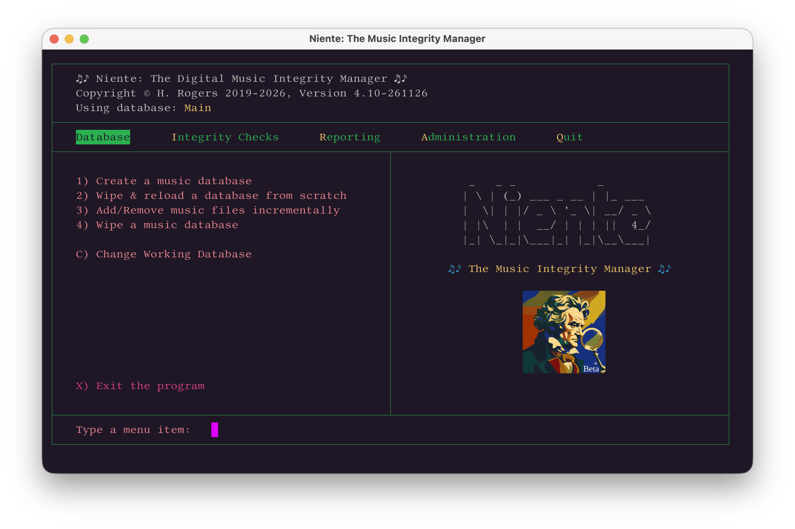

# Niente – The Digital Music Integrity Manager

Niente is a FLAC integrity checker, for macOS, Linux, Windows (via WSL2)
and Raspberry Pi OS. It is licensed under the GPLv2.

You point it at a tree structure of folders full of FLACs and let it
construct a database of what FLAC files exist. You then run a battery of
integrity checks against the register of known FLACs.

Niente will check for **physical** integrity issues (i.e., has this FLAC
become internally corrupt for some reason, such as bit-rot or hard disk
failures).

It will also check for **logical inconsistencies**, such as whether your
FLACs are tagged correctly and coherently. Niente will, for example,
tell you how many of your FLACs don’t have embedded album art, haven’t
had ReplayGain computed or are missing an ARTIST tag. Focussing
especially on how to tag *Classical Music* properly (see [The Axioms of
Classical Music Tagging](https://bbritten.com/articles/axioms)), Niente
can produce seventeen different reports showing violations of the
logical rules of music tagging.

There’s also a built-in advanced SQL querying ability, together with
integration with external tools like DB Browser for SQLite and dBeaver.

Crucially, Niente never *writes* to your FLACs. It only ever reads from
them. Its integrity checks are thus completely safe to perform as often
as you need.

Niente is written in Bash, so is transparent about what it does and how
it does it.

## Installation

On macOS, you need to install either Homebrew or MacPorts package
managers first. On Linux (and Linux running under Windows), your
distro’s package manager is already available for use. On all platforms,
installation is achieved by opening a terminal and typing:

cd\
wget software.bbritten.com/neninst\
bash neninst

The installer will check your system for suitability, install any
necessary prerequisite software, copy down its own scripts and compiled
executables and create a program launcher for you. Running it is then a
matter of simply clicking on the program launcher (on the Linux Desktop;
from your distro’s standard Start menu, under the Multimedia or Sound &
Vision sub-menus; or, on macOS, in the Finder’s Applications folder.

## Quick Start

On first running the program, you should expect to:

1.  Create a new music database

2.  Scan your file system for music files, details of which are loaded
    into the database

3.  Perform a full integrity check

Items 1 and 2 take hardly any time; item 3 can take a couple of hours
for a music collection of tens of thousands of FLACs.

## Full Documentation

Full documentation is available at
https://bbritten.com/softwares/niente/niente.
